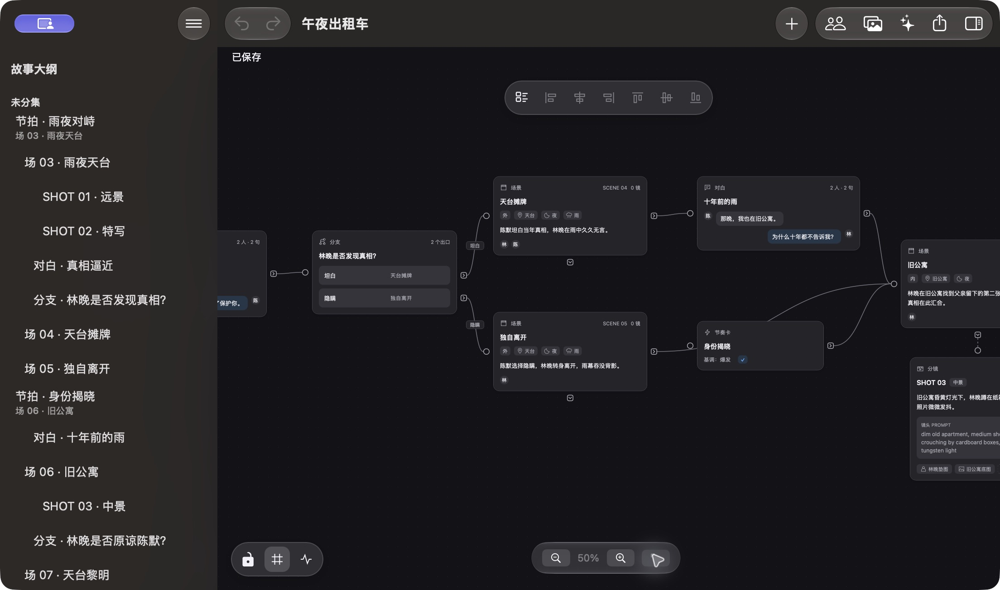

# PlotWeave

**在一张画布上，把故事编成剧本。**

PlotWeave 是面向短剧创作者的 macOS 可视化创作工具。把节奏、场景、对白、分支与分镜放到同一张画布上，从故事构思到剧本导出，随时看清人物、剧情走向与不同结局之间的关系。

[快速上手](docs/guide/quick-start.md) · [项目 Wiki](https://github.com/hailingu/PlotWeave/wiki) · [源码发布](https://github.com/hailingu/PlotWeave/releases) · [反馈问题](https://github.com/hailingu/PlotWeave/issues)

*应用实拍，使用内置合成示例“午夜出租车”。示例用于展示创作流程，你可以创建自己的故事。[截图来源](docs/swiftui-react-flow-current-state.md#readme-截图来源)*

## 可以做什么

### 看清整个故事

用节奏卡、场景、对白、分支、分镜和图片六类节点搭建故事。连线呈现剧情流向，缩放与导航帮助你在局部细节和全局结构之间切换；通过大纲按分集组织内容、调整顺序。

### 编排分支与多结局

把选择、反转和不同结局直接放进故事结构，查看每条路线如何展开、在哪里汇合。适合线性短剧，也适合探索互动叙事。

### 让角色、设定与素材跟上创作

在设定集中管理角色、地点与文档，并关联到剧情节点。通过素材库导入和整理图片、引用项目资产，为场景与分镜补充视觉参考。

### 自由整理，随时修改

拖动、复制、多选、自动排布、六方向对齐与网格吸附，让画布更容易阅读。编辑支持撤销与重做，项目保存在本机；保存失败时会显示提示并提供恢复入口。

### 使用自己的 AI 服务辅助创作

配置兼容的 Provider 和模型后，可在项目内对话、预览并执行 AI 提议的修改，也可为图片节点生成角色参考、场景底图或分镜关键帧。AI 是可选能力，基础编排与导出不依赖 AI 服务。

### 把创作成果带出去

导出 Markdown 剧本及分镜附录；需要交付节奏与分支信息时，可开启“创作大纲”附录。也可以导出 JSON，保留节点、连线、布局、设定与资产引用，供后续处理。

## 从一个想法开始

1. **新建短剧**：为自己的故事创建项目，也可先打开内置示例熟悉画布。
2. **搭建结构**：添加场景与对白，用节奏卡梳理起承转合，用分支连接不同走向。
3. **补充细节**：组织分集、完善角色和地点，加入分镜及参考图片。
4. **导出分享**：预览剧本，按需要复制文本或保存 Markdown / JSON。

具体操作见[快速上手](docs/guide/quick-start.md)。

## 开始使用

当前版本为 **v0.3.0 源码版**，支持 **macOS 26.0 及以上**。[GitHub Release](https://github.com/hailingu/PlotWeave/releases) 提供源码归档，尚无可直接安装的应用包。需要从源码构建的用户，请按[构建与运行指南](docs/development/workflow.md#native-application-launch-and-verification)操作。

AI 功能需自行配置服务地址、模型和 API Key；相关请求由所配置的服务处理，可能产生服务费用。项目数据保存在本机。

## 当前限制

- JSON 导出包含资产引用，不包含媒体文件本体或独立 AI 会话，不能当作完整备份；目前没有 JSON 导入入口。
- 视频制作、资产收藏回库尚未实现。Windows 不受支持，Linux 未验证；VoiceOver 不受支持。
- v0.3.0 仍在演进。完整能力、数据迁移及人工验收边界见[发布说明](docs/releases/v0.3.0.md)与[当前功能状态](docs/swiftui-react-flow-current-state.md)。

## 参与项目

欢迎通过 [Issues](https://github.com/hailingu/PlotWeave/issues) 反馈使用问题和功能建议。参与开发请阅读[开发与贡献指南](docs/development/workflow.md)和 [AGENTS.md](AGENTS.md)。

## 许可证

[MIT](LICENSE)
