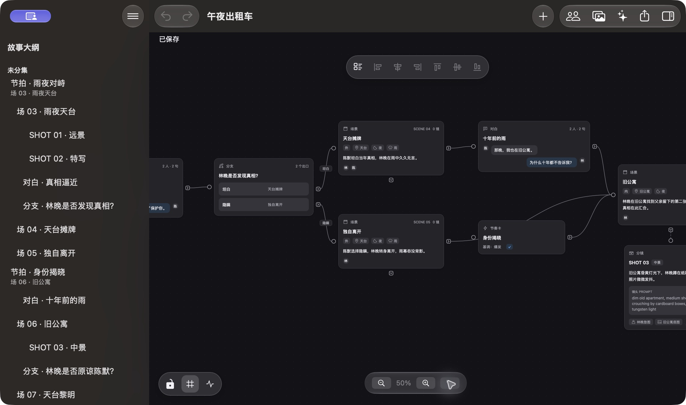

# PlotWeave

[](https://github.com/hailingu/PlotWeave/releases/latest)
[](https://github.com/hailingu/PlotWeave/actions/workflows/ci.yml?query=branch%3Amain+event%3Apush)
[](#从源码运行)
[](package.json)
[](#文档)
[](LICENSE)

**PlotWeave** 是一款面向短剧创作者的可视化桌面工具。它把剧本、场景、角色、道具和剧情分支放到同一张可编辑画布中，让创作者可以直观看见故事结构，组织多线叙事，并将成果导出为可继续加工的文档。



开发版实际运行截图，源码来自 [`b94ac01f`](https://github.com/hailingu/PlotWeave/commit/b94ac01f8276a3aa3c9124bc540555335e6e5590)，画面使用仓库内置合成示例，不代表已发布版本。[截图来源与验证边界](docs/swiftui-react-flow-current-state.md#readme-截图来源)。

## 可以做什么

- 在无限画布上创建、编辑、连接和整理场景、桥段与对白节点。
- 编排多线剧情、反转与多结局，并通过缩放和导航浏览完整故事。
- 管理角色、场景、道具等设定，并把它们与剧情节点关联。
- 多选节点后进行六方向对齐；可开启 22 单位网格吸附。对齐、拖动和方向键移动均支持撤销和重做，键盘每次移动单独记一步历史。
- 导出 Markdown 剧本（含分镜附录）。
- 导出结构化 JSON，保留完整节点、分支、设定与资产引用，便于备份或接入其他工具。JSON 不会打包媒体文件，也不包含 AI 会话。
- 在画布内为图片节点生成角色垫图、场景底图或分镜关键帧；生成结果保存为项目资产。此功能需要配置兼容的 AI Provider。

## 如何理解 PlotWeave

- **画布**是故事的全景图：节点承载叙事内容，连线表达剧情流向。
- **分支**把选择、反转和不同结局直接呈现在故事结构中。
- **设定**集中管理角色、地点与道具，使它们在不同场景中的引用保持一致。
- **项目文件**保存画布与设定；导出的 Markdown 或 JSON 是面向阅读、交换和后续处理的交付格式。

## 当前版本与获取方式

最新公开 Release 为 [v0.2.0](https://github.com/hailingu/PlotWeave/releases/latest)，能力以其[历史发布说明](docs/releases/v0.2.0.md)为准。当前源码为 v0.3.0 开发版，范围见 [v0.3.0 源码说明](docs/releases/v0.3.0.md)，不等同于已公开的 Release。

目前 Release **仅提供源码归档**，尚未提供经过 Developer ID 签名、公证及安装验收的 macOS 安装包。请勿将 GitHub 自动生成的源码压缩包当作可直接安装的应用。

## 技术栈一览

| 部分       | 当前实现                                                                                             |
| ---------- | ---------------------------------------------------------------------------------------------------- |
| 原生应用   | SwiftUI / AppKit 界面，Swift 承接存储、素材、设置、密钥与模型服务                                    |
| 编辑画布   | WKWebView 中的 React / TypeScript / React Flow，维护单一编辑会话与撤销历史                           |
| 保留的基线 | Tauri / React Flow / [Rust 1.95.0](rust-toolchain.toml)，用于既有宿主与契约回归；原生应用不链接 Rust |

工程结构与迁移历史见[开发工作流](docs/development/workflow.md)，当前能力和验收边界见[原生版本状态](docs/swiftui-react-flow-current-state.md)。

## 从源码运行

当前支持 **macOS**，不提供 Windows 构建、测试或发行支持；[平台与工具链细则](docs/development/workflow.md#支持平台)维护在开发文档中。

| 原生构建前置      | 要求                                                                                   |
| ----------------- | -------------------------------------------------------------------------------------- |
| 系统              | macOS 26.0+                                                                            |
| Node.js           | [24.18.0 起的 24.x，或 26.0.0 及以上](package.json)；默认运行版本见 [`.nvmrc`](.nvmrc) |
| Xcode / macOS SDK | [27.0 / 27.0](docs/swiftui-react-flow-toolchain.md)，Swift 6 语言模式                  |

原生构建无需 Rust。完整环境配置与 Node 版本兼容细则见[开发工作流](docs/development/workflow.md#nodejs-最低版本与运行版本)：

```bash
nvm use
npm install
npm run build:native
open -n native/macos/build/DerivedData/Build/Products/Debug/PlotWeaveNative.app
```

AI 功能需自行配置可用的 Provider；PlotWeave **不支持 VoiceOver**。数据隔离、迁移历史及人工验收边界见[开发运行说明](docs/development/workflow.md#原生应用启动与验证)和[当前功能状态](docs/swiftui-react-flow-current-state.md)。

保留的 Tauri 基线运行方式见[开发环境配置](docs/development/workflow.md#tauri-基线开发环境)。源码构建不等同于发行安装包。

## 文档

- [v0.3.0 源码说明](docs/releases/v0.3.0.md)与 [v0.2.0 历史发布说明](docs/releases/v0.2.0.md)
- [数据模型与项目格式](docs/data-model/README.md)
- [界面与交互设计](docs/ui-design.md)
- [SwiftUI/AppKit + React Flow 改造计划](docs/swiftui-react-flow-migration-plan.md)与[当前功能、证据及验收边界](docs/swiftui-react-flow-current-state.md)
- [开发与贡献指南](docs/development/workflow.md)

## 开发与贡献

开发者请从 `dev` 创建任务分支，并先阅读 [AGENTS.md](AGENTS.md) 与[开发工作流](docs/development/workflow.md)。分支策略、PR 持续集成、质量门禁、仓库结构、技术栈及发布步骤统一维护在开发文档中，不在产品 README 中重复。

## 许可证

[MIT](LICENSE)
