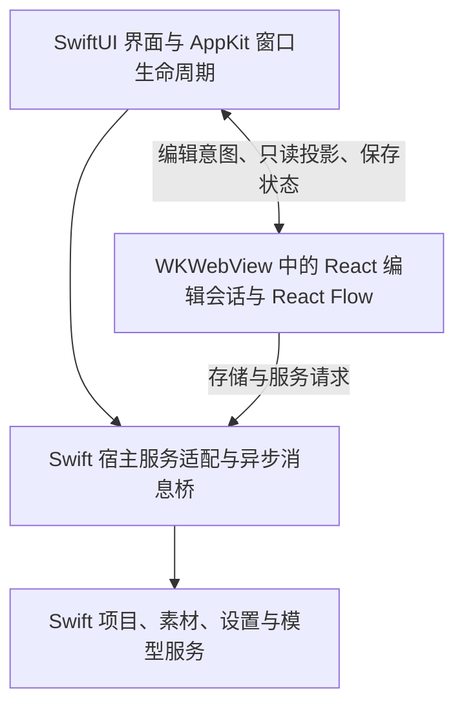

# SwiftUI/AppKit 外壳与 React Flow 画布改造计划

> 决策日期：2026-09-15。依据：仓库所有者在本任务中明确选择 SwiftUI/AppKit 外壳 + React Flow 画布，要求建立分支并分阶段开发验证。
> 工作分支：`codex/swiftui-react-flow`；起点为当前本地 `dev`：`fa74520e20497359205ed1f2055115b2d6f90c79`。未同步远端。
> 当前状态（2026-10-04）：P0 完成；P1 的窗口、画布、握手、外观同步与不重建 WebView 已有自动化证据，视觉与性能对照仍待人工验证。P2 桥接、Swift 持久化编辑链路和退出屏障，以及 P3/P4 现有业务界面与 Swift 服务已实现并完成分域验证；最终路由结果及保留缺口见[功能补齐记录](swiftui-react-flow-feature-parity.md)。P5 的输入法、VoiceOver、系统面板、视觉、手势与性能实测尚未完成；本分支为本地验证版本。此前 Rust/core/C ABI 阶段保留为历史和 Tauri 回归基线。
> 2026-10-04 本地 `dev` 合并同步：保留上述原生阶段边界并导入最新数据安全、类型/模块边界与完整质量门禁；当前演示入口迁至 `src/editor/nativeCanvas/`，宿主服务复用统一 IPC 传输，详情见[P2 合并同步](swiftui-react-flow-p2-evidence.md#dev-合并兼容性同步2026-10-04)。历史测试数量保留在原证据中，本次验证另行记录。
> 2026-10-07 工具链更新：所有者要求切换到 Xcode 27；当前固定为 Xcode 27.0 / macOS SDK 27.0 / Swift 6 语言模式，native CI 使用 `xcode-27` 并显式选择 27.0。最低部署版本仍为 macOS 26.0；主目录原 P1/P2 演示现由恢复的完整业务实现替代，历史工具链证据保留，当前记录见 [Xcode 27 工具链同步](swiftui-react-flow-p1-evidence.md#xcode-27-工具链同步2026-10-07)。
> 2026-10-04 工具链升级：所有者明确授权采用 Xcode 27.0／Swift 6.4 编译器／macOS SDK 27.0；Swift 6 语言模式与 macOS 26.0 部署目标保持。当前工具链依据与本次验证结果见[工具链升级记录](swiftui-react-flow-toolchain.md)，P1 与原合并的数值仍保留为历史证据。
> 2026-10-04 路线修订：所有者明确要求“存储、素材和模型服务也用 Swift 实现”。以下目标改为 SwiftUI/AppKit 业务界面 + Swift 原生服务 + React Flow 画布。P2 已完成的 Rust/core/C ABI 留作历史和 Tauri 回归基线，不再作为新原生产品依赖；本次功能实现与待验证项见[功能补齐记录](swiftui-react-flow-feature-parity.md)。
> 配套：[UI 设计 §12](ui-design.md#十二macos-原生界面与服务已实现验收边界保留)、[数据模型主题索引](data-model/README.md)、[工程规范](development/software-engineering-standard.md)、[仓库工作流](../AGENTS.md)。

## 1. 目标与范围

本分支沿一个方向持续演进：以 SwiftUI/AppKit 承载 macOS 应用外壳与系统交互，以 WKWebView 内的 React Flow 承载画布，以 Swift 原生服务承载文件、资产、设置和模型请求。

首要交付是能运行、能观察、能重复验证的原生编辑窗口，随后逐步达到当前版本的功能完整度。每阶段都留下启动方式、验证步骤、结果及剩余缺口，避免视觉样机被误认为完整产品。

- 原生部署目标为 macOS 26.0+。当前构建配置按所有者 2026-10-04 决策采用 Xcode 27.0／Swift 6.4 编译器／macOS SDK 27.0，Swift 6 语言模式保持；原工作树 macOS 26.6.2 的历史结果与 CI macOS 27.0 配置分别记录，本次合入在主目录当前系统执行，见[当前工具链](swiftui-react-flow-toolchain.md)。P1 的原始工具链记录保留为当时证据；旧系统支持不作为本轮承诺。
- 原生化范围包括窗口、工具栏、导航侧栏、属性检查器、项目首页、设置和应用菜单。AI 与资产面板同样迁为 SwiftUI；Web 仅保留画布内容与其编辑会话。
- 保留节点、连线、画布内联编辑、选框、拖拽、缩放、端口命中与画布内浮层的 Web 实现；不逐节点创建原生视图。
- 复用现有会话模型、归一化与撤销语义；Swift 服务对齐既有存储格式、业务合同与资产信任边界；本计划不升级文件 schema，不改变既有已登记边界。
- P0 交付只包含分支与文档。P1 起新增源码、工程和测试；发布、签名分发与真实模型计费调用分别按实际任务授权执行。

## 2. 固定的目标架构



### 2.1 职责和状态归属

| 部分 | 最终责任 | 约束 |
| --- | --- | --- |
| SwiftUI | 项目首页、工具栏、侧栏、检查器、设置及面板 UI | 画布文档只读投影；表单草稿不构成第二份可写文档 |
| AppKit | WKWebView 嵌入、窗口关闭与应用退出、菜单命令、焦点及系统集成 | 在 SwiftUI 声明式界面与系统生命周期之间提供明确适配 |
| React 编辑会话 | 会话文档、图操作、选择和视口、撤销重做、AI 命令执行、项目写入协调 | 延续单会话写入者；所有原生编辑操作进入同一应用动作入口 |
| React Flow | 节点/连线渲染及连续交互 | 逐帧坐标留在 Web；不等待原生往返才显示拖拽结果 |
| Swift 宿主服务 | 本地资源加载、Web 请求分发、原生非文档服务调用 | 明确区分应用服务请求与会话编辑命令，不能绕过写入协调 |
| Swift 原生服务 | 项目/库/设置/密钥/媒体/模型请求能力 | 显式数据根、后台 I/O、结构化错误；对齐既有数据与恢复合同 |

原生主程序最终不依赖 Tauri 运行时。迁移期间保留现有 Tauri 入口作为功能回归基线；新 Swift 实现以其行为和文件合同作对照，它不再承担本分支新外壳的产品实现。

### 2.2 界面组合与玻璃规则

- 优先采用系统工具栏、侧栏和检查器的标准结构；自定义浮动控件需要玻璃时使用 SwiftUI `glassEffect` 或 AppKit `NSGlassEffectView`，相邻玻璃合理归组。
- 玻璃用于导航和操作区域，剧本卡片、图片与画布保持清晰内容表面。画布默认不透明，原生玻璃位于其上方或相邻区域；P1 验证真实 Web 内容的采样、裁剪与层级。
- 不把整窗透明、KVC 私有背景属性或全局 `background: transparent !important` 作为接入前提。WKWebView 使用 macOS 公开 API，不能照搬 UIKit 的背景配置。
- 由原生布局决定 WebView 可用区域；安全区、工具栏覆盖和侧栏收展的几何变化统一传递，避免重复预留空白或隐藏节点命中区域。
- 保留系统浅深外观；原生侧读取减少动态效果、减少透明度与增强对比度设置，并向 Web 同步需要的语义状态，不能只假定媒体查询在目标 WebKit 上全部生效。
- Apple 官方 Figma UI Kit 用于尺寸、层级、控件状态与设计标注；原生材质由系统实现，CSS 只承接 Web 内容样式。实际采用文件与控件映射已于 P1 记录（基准 macOS 26 UI Kit，Figma Community file 1543337041090580818；官方入口当前列 macOS 27 kit 作后续对照），见 [P1 证据记录](swiftui-react-flow-p1-evidence.md)「P1-4/5」节；kit 内具体组件节点链接待在设计工具中定位后补齐。

### 2.3 当前目录归属

以下目录已建立。`src/platform/` 提供 Tauri／Swift／browser 适配；`native/macos/App/` 实现 SwiftUI 业务界面及 Swift 服务，`native/macos/Tests/` 提供临时根、真实 WK 与注入网络回归。Rust crate 不进入新原生应用链接：

| 目录 | 责任 |
| --- | --- |
| `native/macos/` | SwiftUI/AppKit 应用、Web 宿主适配、原生单测及 UI 测试 |
| `crates/plotweave-core/` | 既有 P2 项目存储内核；保留 Tauri 及历史回归，不继续为原生逐域抽离 |
| `crates/plotweave-ffi/` | 既有 P2 静态库及 C ABI 历史实现；新 Swift 宿主不链接 |
| `src/platform/` | 前端宿主接口、Tauri/Swift 适配及可控测试实现 |
| `src/editor/` | 继续持有编辑会话、图操作、历史栈及 React Flow 组件 |

在新增首个 Swift、Xcode 工程或新 Rust crate 的同一变更中，必须先补 `AGENTS.md` Scope Routing、对应语言规范和实际可运行的非交互验证命令。当前原生 scheme 为 `PlotWeaveNative`，实际非交互命令见 `AGENTS.md` 与[工作流](development/workflow.md)。公共接口文档、文件及函数规模沿用工程规范，并在新增路由中明确覆盖新目录。

## 3. 现有能力与迁移接缝

以下是基于分支起点的实现映射，后续优先复用：

| 现有入口 | 改造要求 |
| --- | --- |
| `src/App.tsx` | 拆出独立于页面外壳的应用会话运行层，保留首页刷新、最新文档、未保存 AI 历史和切页恢复行为 |
| `src/editor/useEditorDocument.ts`、`history.ts`、`useEditorController.ts` | 继续拥有文档与命令历史；将原生操作接入现有按域动作，不重新设计整套 GraphStore |
| `src/editor/EditorCanvasRegion.tsx`、`useNodeDragHistory.ts` | 保留画布渲染隔离与整段拖拽一步撤销；缩放平移继续由 React Flow 处理 |
| `src/editor/useEditorPersistence.ts`、`src/projectStore/saveChain.ts` | 保留防抖、顺序写入、失败登记与删除期间写入的恢复语义 |
| `src/useExitFlush.ts`、`src-tauri/src/native_quit.rs` | 将原生退出入口接到同一保存屏障；不能直接关闭 WebView 或 terminate 应用 |
| `src/projectStore.ts`、`src/settings/settingsStore.ts`、`src/library/libraryStore.ts`、`src/aiSessionStore.ts` | 逐一收敛 Tauri 直接调用，保持门面语义与浏览器测试回退；明确 Swift 宿主识别，不能误落入内存模式 |
| `src-tauri/src/store/`、`library/`、`assets/`、`prefs.rs`、`imagegen.rs` | 作为 Swift 同功能实现的磁盘、校验、错误与恢复合同参考；Tauri 源码保持回归基线（已有 P2-2 store 域抽离保持） |
| `src-tauri/src/library/media.rs` 与资产读取内核 | 以 WKURLSchemeHandler 承接 `pwmedia` 语义，以 Swift 实现相同 scope、assetId、会话索引及媒体限读合同 |

2026-10-04 修订后的实现顺序为 Swift 项目存储、媒体/素材、设置/密钥与模型服务。Rust/Tauri 不再继续抽离；保持旧产品回归，逐域以临时目录、本地 HTTP 夹具和双向文件合同验证 Swift 实现。

## 4. 消息、命令与生命周期设计约束

本节定义已经实现的协议约束；磁盘格式和既有命令合同仍以数据模型正文为准。具体版本化载荷、错误码与验证结果见[功能补齐记录](swiftui-react-flow-feature-parity.md#桥合同)。

### 4.1 双向桥接

1. Web 就绪握手确认协议版本和能力，再允许原生控件发编辑命令。首次加载失败提供可见错误，不显示虚假的空项目。
2. 请求携带请求身份与会话身份，编辑请求绑定项目及目标实体；返回成功或结构化失败。旧会话的迟到结果不能改变当前界面。
3. 原生选择、表单提交、菜单撤销和重做进入 React 会话的统一动作入口，返回执行后的只读投影、撤销可用性与保存状态。文本输入焦点优先保留输入框的撤销语义。
4. 编辑序号仅用于当前进程的消息顺序与陈旧投影判定，不复用 `aiRevision`，不写入磁盘 schema，不引入跨进程合并机制。
5. 预览更新可以合并为最新值；正式编辑命令不能被节流丢弃。先从选择/修改结束通知开始，只有实际原生反馈需要才增加拖拽过程投影。
6. 超时表示结果未知，不能自动重放删除、复制或计费请求。相同会话内重复请求须返回既有结果或查询执行状态，不重复产生副作用。
7. 导航限制为应用受信内容；业务载荷在桥接和 Swift 服务边界校验。媒体通过资源协议读取，不通过逐帧 JSON 或 base64 大载荷传送。

### 4.2 写入与会话存活

- Web 编辑会话继续协调画布、AI 会话和项目资产相关写入；原生项目删除、复制等操作同样进入应用协调入口，不能直接绕过保存/删除队列调用原生存储。
- 返回首页可以保持现有立即显示列表的行为，但应用会话运行层及失败快照继续存活；保存成功后刷新原生首页，失败不得虚报新摘要。
- 切换项目时只保留一个活动编辑写入者，旧项目的在途/失败保存仍由应用级协调层管理；旧会话回调不能操作新项目。重开项目先按既有保存链与失败快照恢复规则处理。
- 打开设置、收展侧栏或切换面板不能重建编辑器并装入旧快照。WebView 生命周期独立于这些视图可见性变化。
- 关闭窗口、⌘Q、Dock 退出均先等待画布、项目写入链、设置和 AI 会话冲刷。失败保留窗口、会话与重试入口；启动握手前的退出走同一缓冲语义。
- [PR #526](https://github.com/hailingu/PlotWeave/pull/526) 保留就绪页面的 `terminateLater`：Web 冲刷成功回复 `true`，失败／桥投递错误／替换页面／当前页面进程或导航失效回复 `false`；未就绪先取消系统请求并保留启动意图。Swift `app_exit` 的可选布尔 `cancel` 只增加失败回执，Tauri 载荷保持；不一律取消后重发成功系统终止序列。统一页面失效入口撤销监听及缓冲，重载后须明确重试；旧连接不能取消新页退出，见修复矩阵 R27。真实菜单／Dock 和系统注销尚待人工验证。
- Web 内容进程异常退出须停止写命令并显示恢复提示；只恢复可确认的已保存状态，不以空图覆盖磁盘。进程崩溃后的未落盘编辑恢复仍是明确缺口，不在此次迁移中凭空承诺。

### 4.3 Swift 原生服务边界

- Swift 原生服务实现存储、校验、资产事务、设置加密与模型 HTTP；磁盘 schema 不升级。前端归一化与单一会话编辑协调保持，媒体字节走独立资源通道。新应用不链接 Rust/Tauri。
- I/O、模型请求和大载荷解析不占用主线程；Swift UI 与 WebKit API 回到主线程更新，异步任务由显式生命周期对象管理。
- 明确定义任务所有权、取消、会话失效、资源交付和错误转换；取消及关闭不得留下无归属写入或不可观察失败。
- 验证应用使用独立数据根与测试身份，路径从宿主注入。正式 app 标识、旧数据定位、Keychain 身份及既有密文的兼容性在 P4 验证前不得切换到用户真实数据。
- 新旧宿主不得同时写同一份数据；沿用单实例使用范围，不新增跨进程锁或多写者同步方案。

## 5. 分阶段开发顺序

### P0：建立分支与计划（本次完成）

- [x] 从本地 `dev` 建立 `codex/swiftui-react-flow`，保留已有工作区改动。
- [x] 记录架构、职责、迁移接缝、阶段和验收矩阵。
- [x] 同步 README、UI 设计和数据模型中的改造入口，并区分当前实现与目标。

本次按文档路由进行结构化审阅：核对现有入口、当前/目标状态、章节引用、阶段依赖与矩阵覆盖。仓库未配置文档自动化检查；补充执行 `git diff --check` 与新文件的补丁空白检查。未修改源码，未运行构建、源码测试或 SonarQube，未提交或推送。

### P1：原生窗口与真实画布的视觉首片

- [x] 补 Swift/macOS 工程规范、Scope Routing 和工具链记录，建立可重复构建与启动的原生应用工程。
- [x] 建立 SwiftUI 外壳、原生工具栏/侧栏容器和 AppKit WKWebView 宿主，加载打包的 Web 资源。
- [ ] 复用现有 React Flow 节点与内容样式，加载确定性的脱敏夹具，支持拖拽、连线、平移和缩放；明确标记为内存演示数据。
- [ ] 在同机同夹具上记录当前 Tauri 版本与原生首片的视觉和性能基线，按 §7 固定后续常用场景的验收阈值。
- [ ] 记录 Apple Figma 参考与控件映射，完成浅深外观、窗口缩放、侧栏收展、玻璃覆盖与命中区域验证。
- [ ] 验证握手、加载失败、系统外观同步及面板变化不重建 WebView。

首项进展（2026-09-15）：已固定工具链（macOS 26.6.2 / Xcode 26.6 / Swift 6.3.3 / macOS SDK 26.5 / Apple M4 Max），新增 [swift-standard.md](development/swift-standard.md)，在 `AGENTS.md` Scope Routing 增加 `native/**` 路由（规模上限同步覆盖），并建立手工维护的 Xcode 工程 `native/macos/PlotWeaveNative.xcodeproj`（App 目标 + Swift Testing 单测目标、已提交共享 scheme、ad-hoc 签名、部署目标 26.0）。构建、测试、启动与正常退出验证通过；窗口截图因本机屏幕录制授权缺失暂缺。命令、结果与缺口见 [P1 证据记录](swiftui-react-flow-p1-evidence.md)。

外壳容器半片（2026-09-15，第 2 项前半）：`NativeShellRoot` 以 `NavigationSplitView` + 统一工具栏 + 尾随检查器建立标准容器（玻璃由系统提供），画布区为不透明占位 + 悬浮玻璃控件簇（`glassEffect`，禁用态并标注原因）；`ShellLayoutState` 承载检查器可见性（先红后绿，2 套件 / 4 测试通过）。WKWebView 宿主与 Web 资源加载仍待做；玻璃视觉需目验（截图仍缺屏幕录制授权）。详见 [P1 证据记录](swiftui-react-flow-p1-evidence.md)。

画布首片（2026-09-15，第 2 项后半 + 第 3 项实现）：WKWebView 宿主（ready 握手 / 失败诊断 / 就绪超时 / 重试 / 仅放行 `file://` / 禁原生缩放防双重缩放）加载 `npm run build:native-canvas` 打包的画布演示页——复用生产节点与连线注册（`canvasRegistry` 单一来源）、`graphRules` 校验与 `NodeEditContext` 的确定性脱敏夹具（9 节点 / 7 边，全类型与三种连线语义），页面常驻"内存演示数据 · 不落盘"徽标，生成调度按 §4.1 显式禁用。两端先红后绿（Web 9 测试、Swift 3 套件 9 测试），前端路由检查（format/lint/build/120 文件 1477 测试）通过。随后所有者启动暴露加载超时，已修正 `file://` 下的模块脚本加载方式（单一 IIFE 经典入口）并补齐 React Flow 基础 CSS；真实 WKWebView 回归已覆盖 ready、9 节点样式及失败后重试，实际窗口已显示画布；第 3 项勾选待所有者目验（节点渲染、拖拽/连线/平移/缩放）与补截图后完成。详见 [P1 证据记录](swiftui-react-flow-p1-evidence.md)。

外观同步与面板生命周期（2026-09-15，第 6 项代码部分）：`CanvasAppearanceState` 以 `NSApp.effectiveAppearance` + `NSWorkspace` 三项辅助设置为宿主语义单来源（KVO 观测、仅实际变化推送），document-start 注入初始快照、ready 后对齐、变化经 `__pwApplyHostAppearance` 推送；Web 桥逐字段校验载荷并把语义落到 `<html>` data 属性（§2.2）。`ShellLayoutState.sidebarVisible` 成为侧栏收展单一来源；真实窗口测试验证检查器开关与侧栏收展不重建 WKWebView、不重载页面（§4.2）。两端先红后绿（Web 4 文件 21 测试、Swift 6 套件 15 测试），前端路由检查（122 文件 1489 测试）通过。第 6 项勾选待所有者完成真实系统外观/辅助设置切换的目验。详见 [P1 证据记录](swiftui-react-flow-p1-evidence.md)。

Figma 参考与基线准备（2026-09-15，第 4–5 项推进）：控件映射与采用文件已记录（基准 macOS 26 UI Kit，见 §2.2 与证据记录「P1-4/5」节）；§7.2 性能夹具与指标规格定稿（常用-100/500、压力-1000，两宿主同机同夹具）；原生首片冷加载→ready 已有单次观测（约 0.30 秒）；Tauri 同夹具对比的接入路径（dev 入口伺服 `native-canvas.html`）与缺口已登记，未完成前不冒充基线。本会话无屏幕录制/AX 授权，视觉目验与截图按证据记录中的所有者目验指引执行；第 3、6 项勾选待目验通过。

**完成条件**：在原生窗口内可操作现有类型节点；有可复现的启动命令、截图和操作录屏；无白屏、错位、事件穿透或输入被遮挡。此阶段不访问用户数据、不接真实模型服务，不以数据未落盘声称功能回归通过。

### P2：桥接与第一条可持久化编辑链路

- [x] 收敛前端宿主接口，明确 Swift 与 Tauri 适配，保持当前宿主回归可运行。
- [x] 抽出 Rust 项目存储内核并接入 C ABI，验证分配/释放、异步完成、错误与取消。
- [x] 在临时根以 Swift 实现打开项目 → 编辑 → 防抖保存 → 关闭冲刷 → 重开恢复，真实 WK 文件往返验证通过；复用既有写入失败恢复回归。
- [x] 接通正式编辑命令与状态投影，覆盖陈旧会话、重复请求、乱序响应、节点已删除等边界。
- [x] 接入退出固定点屏障，等待画布、项目、AI、设置及在途密钥写入，失败留窗；系统菜单／Dock 的人工操作待验证。

存储内核抽出与 C ABI（2026-09-15，第 2 项）：store 域（types/validate/persist/list/commands/copy + isotime）整体迁至 `crates/plotweave-core`（宿主无关、数据根注入 `open_projects_root`，原 75 项 store 测试随迁全绿）；src-tauri 保留薄命令适配与 `crate::store::` re-export，外部域零改动、201 项测试全绿。`crates/plotweave-ffi` 提供 C ABI：不透明句柄 + JSON 请求/回执、单工作线程串行执行与完成回调（非主线程）、未派发取消、`catch_unwind` 包裹（panic 转结构化 ERROR）、结果字符串分配/释放契约；先红（ABI 集成测试因缺库失败 + 确定性取消/panic 单测）后绿（ABI 集成 5 项：创建→保存→重开恢复→删除、错误上浮、取消 no-op、坏输入拒绝）。同变更补 `AGENTS.md` `crates/**` 路由、rust-standard crate 布局节与 `.gitignore`。命令与缺口见 [P2 证据记录](swiftui-react-flow-p2-evidence.md)。

宿主接口收敛（2026-09-15，第 1 项）：`src/platform/` 落地——`hostEnvironment` 为宿主识别单一来源（tauri > swift > browser，Swift 宿主经原生注入的 `window.__pwNativeHost={kind:"swift"}` 识别，内存回退仅限纯浏览器预览），`hostInvoke` 为命令传输统一入口（swift 宿主以稳定错误码 `PW_HOST_COMMAND_UNAVAILABLE` 可见失败，其余宿主路由 `@tauri-apps/api/core` invoke、行为与收敛前等价）。8 个 store/门面（项目/保存链/设置/库/AI 会话/项目资产/对话通道/图片生成）的 `isTauri` 判定与约 30 处 invoke 直调全部收敛；原生 document-start 脚本同批注入宿主标记（M17）。两端先红后绿（Web 3 文件 20 测试、Swift 真实 WebKit 标记注入），前端路由检查（125 文件 1509 测试）与原生路由检查（6 套件 16 测试）通过。命令、结果与缺口见 [P2 证据记录](swiftui-react-flow-p2-evidence.md)。

**完成条件**：隔离数据目录中的真实文件可往返恢复；失败会阻止不安全的关闭；桥接模拟测试、真实 WK↔Swift 文件调用和原生生命周期测试都有证据；Rust ABI 仅保留历史结果。

### P3：原生编辑外壳与统一命令行为

2026-10-07 主目录曾补齐演示 Home 导航；完整生产源码现已恢复到同一分支，该演示入口由真实项目片库替代。原始回归保留为[历史证据](swiftui-react-flow-p1-evidence.md#home-图标与演示首页导航2026-10-07)，本次集成验证见[合入记录](swiftui-react-flow-integration.md)。

- [x] 接通原生项目首页、导航侧栏、工具栏和属性检查器，保持单项目导航语义。
- [ ] 原生属性编辑、画布内联编辑与现有图动作已共用历史栈；连续提交／稳定目标／撤销回归通过。中文输入法、失焦、菜单撤销与键盘焦点仍待逐项人工验证。
- [x] 自动化验证设置往返和收展面板保留同一 WebView／编辑会话、当前文档与投影顺序；实际视觉连续性待 P5。
- [x] 接通项目创建、复制、删除和导出，覆盖在途保存、失败重试与首页刷新顺序。
- [x] 原生 send／request 在跨桥前登记在途意图，退出先等待其完成，再进入 Web 保存固定点；最终批准拒绝冲刷期间新增意图，取消后的旧投递不重放。独立触发条件、失败重试与真实磁盘验证见 [PR #526 R29](swiftui-react-flow-pr526-fixes.md#原生意图进入退出屏障)。

**完成条件**：原生面板能完成当前编辑主流程；一次拖拽一步撤销；跨界面编辑顺序一致；复制/删除作用于正确项目且不丢失更新。

### P4：媒体、设置与 AI 功能对齐

- [x] 以 Swift 实现图库、项目资产、设置／密钥与模型服务，对齐既有合同；`pwmedia` 已通过真实 WK 图像解码验证。
- [x] 接通原生设置页、保存失败与成功后模型消费者重载；在独立根用合成测试密钥验证 pw1/pw2 兼容，不读历史 Keychain。
- [x] 未提交密钥由设置页按供应商身份持有，跨滚动／同页表单重建保留，提交、整页离开及供应商删除清稿；真实 SwiftUI 控件回归与直接虚拟化复现缺口见 [PR #526 R28](swiftui-react-flow-pr526-fixes.md#设置滚动与密钥草稿)。
- [x] 接通 AI 对话、预览确认／执行、图片生成、取消和迟到结果守卫；注入传输与本地 HTTP 夹具通过。真实公网 TLS 信任链及计费调用未验证。
- [x] 图库与 AI 面板、图像生成表单均由 SwiftUI 实现，React 保留作业、会话协调与命令执行；画布节点继续使用现有 Web 渲染。
- [x] 退出状态机与实际 WK 冲刷覆盖所有保存所有者；临时根项目／媒体／AI／设置合同与恢复用例通过。真实旧用户数据迁移和系统菜单／Dock 人工操作未执行。

**完成条件**：功能清单逐项有新宿主证据；媒体与模型请求的失败仍可恢复；存储格式及现有已知边界未被隐式改变。真实服务未测试时明确记录该缺口。

### P5：视觉、性能与完整回归收敛

- [ ] 按 §7 统一场景补齐视觉、辅助功能、手势和性能证据，修复重复建层、无关重渲染与主线程阻塞等已测得问题。
- [ ] 完整执行前端、Rust、新增原生工程的路由检查；覆盖真实 WebKit/原生组合，不能只以浏览器单测代替。
- [ ] 同步实际目录、启动说明、已实现状态和保留边界，形成可继续开发的验证版本记录。

**完成条件**：选定矩阵行全部有通过证据或明确未通过项；仍有数据正确性/必要功能缺口时不宣布改造完成。是否分发或合并依据对应任务与仓库门禁执行，不因 P5 计划存在而自动授权。

## 6. 关键状态与不变量矩阵

这是原计划的风险矩阵。当前功能证据映射至[补齐矩阵 F01–F14](swiftui-react-flow-feature-parity.md#实现前关键状态与不变量矩阵)：M01/04/05/14/16/17 对应 F01/02/06/11，M07–10 对应 F03–05，M11–12 对应 F07–09/12，M06 对应 F06/13。下表保留早期验证描述作为历史，不能将“待验证”自动计作通过；当前未覆盖的视觉／输入／性能为 M02/03/06/13/15。

| ID / 阶段 | 前置状态 | 动作与事件顺序 | 可观察结果 | 不变量及责任方 / 入口 | 计划验证与当前缺口 |
| --- | --- | --- | --- | --- | --- |
| M01 / P1 | Web 未就绪或资源失败 | 启动后立即操作工具栏 | 就绪前禁用编辑，失败显示诊断 | 宿主仅向有效会话发命令；启动/重载/工具栏 | 原生 UI 测试，待实现 |
| M02 / P1 | 画布有节点且已缩放 | 收展侧栏、调整窗口、切换外观 | 节点位置和命中一致，无白底闪烁 | 宿主布局与 Web 坐标各自单一来源；所有面板入口 | 真机截图、录屏与 UI 测试，待验证（面板切换不重建 WebView 已由 P1-6 真实窗口测试覆盖） |
| M03 / P1/P3 | 指针位于画布、文本框或滚动面板 | 滚动、捏合、双击、空格拖拽与组合输入 | 各区域正确处理输入，不双重缩放或截断中文 | 焦点/事件由宿主与 Web 明确交接 | 触控板、鼠标与输入法实测，待验证 |
| M04 / P2/P3 | 会话 A 有未完成请求，随后打开 B | A 响应晚到；旧属性投影晚于新编辑 | B 不被改变，面板不退回旧值 | 会话身份与编辑顺序属于应用会话；桥接/设置/项目切换 | 可控乱序测试及新宿主集成，待实现 |
| M05 / P2/P3 | 正式编辑请求已执行，回执丢失 | 重发同一请求；目标在提交前被删 | 不重复执行，不重建已删实体；返回真实状态/错误 | 会话命令入口拥有去重与目标校验 | 删除、复制、属性提交的行为测试，待实现 |
| M06 / P3 | 一组节点开始拖拽 | 连续移动→松手→菜单撤销→重做 | 分别恢复起点和终点，一段拖拽一步历史 | React 会话拥有图历史；Web 拖拽/原生菜单/快捷键 | 复用拖拽历史测试并补真实菜单路径，待验证 |
| M07 / P2/P3 | A 保存在途，随后产生新编辑 B | 旧保存失败/成功→重试→重开 | 最终恢复 B，失败可见且快照保留 | 写入协调层保持顺序和最新快照；防抖/手动/退出/重开 | 故障注入+实际文件往返，待验证 |
| M08 / P3 | 有在途保存或失败 AI 快照 | 回首页→保存落定；设置往返；切换项目 | 首页反映实际落盘，重开不丢进程内最新数据 | 应用会话寿命不依赖页面；原生导航/保存事件 | 生命周期集成测试，待验证 |
| M09 / P3/P4 | 项目写入在途 | 删除开始→迟到写入→删除成功或失败 | 成功不复活，失败保留并回吐应保存内容 | 同一项目协调链拥有删除与附属写入顺序 | 复用保存/删除测试并覆盖原生按钮，待验证 |
| M10 / P2/P4 | 有画布脏态、项目重试或 AI 待写；含启动间隙 | 关窗/⌘Q/Dock 退出→冲刷期间新编辑或失败 | 等待全部必要写入；失败留窗可重试 | 应用退出屏障拥有终止权；所有关闭入口 | 现有屏障语义+AppKit 集成，待验证 |
| M11 / P4 | 媒体有效、缺失、脏索引或请求已取消 | 加载→切项目/移除视图→迟到完成 | 正确图像或可读占位，无越界读取/失效回调 | Swift 媒体服务与 WK 资源适配；项目/库/生成图片 | 协议测试+真机解码，待验证 |
| M12 / P4 | 图像生成运行，或 AI 批次待确认 | 取消/删节点/切会话→旧结果返回；确认时内容已变 | 不覆盖新作业或错项目，执行保持既有校验 | 现有 AI 控制器与 Swift 模型服务；原生面板/Web 节点 | 本地服务故障注入，真实计费服务尚未验证 |
| M13 / P1/P5 | 浅深色及辅助功能组合 | 切换透明度/对比度/动态效果并操作控件 | 原生与 Web 一致适配，内容可读可操作 | 外观由宿主同步，Web 语义令牌消费 | 视觉审阅、键盘与 VoiceOver 实测，待验证（宿主语义同步管线已由 P1-6 自动化覆盖） |
| M14 / P2/P5 | Swift 请求在途或 Web 进程异常结束 | 取消/释放宿主/迟到回调/重载 | 无失效内存访问，不拿空状态覆盖文件 | Swift 任务所有权与宿主生命周期 | 部分验证（P2-2，2026-09-15）：取消门（未派发转 CANCELLED）、释放（free 前排空回调、join 后不再回调）、坏输入拒绝与 panic 不跨 FFI 已由 Rust 侧 ABI 测试覆盖；上述仅为历史 Rust ABI 证据；当前 Swift 页面、排队请求取消和进程失效回归见 F11，未落盘崩溃恢复不作保证 |
| M15 / P5 | 固定规模与内容的图 | 持续拖拽、缩放、面板操作、打开/关闭 | 操作连续，内存无持续无界增长 | React 渲染隔离、桥接合并与原生任务调度 | §7 性能记录，尚无测量结果 |
| M16 / P2 | 页面分别运行于 Tauri webview、Swift WKWebView（原生注入 `__pwNativeHost={kind:'swift'}`）、纯浏览器预览 | 经统一平台层调用任一 store 门面（项目/设置/库/AI 会话/项目资产/模型代理） | Tauri：命令与载荷经平台传输原样到达 `invoke`，行为与收敛前等价；Swift：有效会话路由至 Swift 服务，缺桥／未知命令携带稳定错误；浏览器：内存回退与现状一致 | 宿主识别单一来源、优先级 tauri > swift > browser；Swift 宿主绝不落入内存回退（§3「不能误落入内存模式」）；内存回退仅限纯浏览器预览 | 已验证（P2-1，2026-09-15）：平台层单测 + `memoryFallbackBoundary` 门面测试先红后绿 + 既有 `.tauri.test.ts` 套件回归全绿，详见 [P2 证据记录](swiftui-react-flow-p2-evidence.md)；该切片当时未含 Swift 退出；2026-10-04 的 Swift 传输与退出结果见 F01/F05 |
| M17 / P2 | 原生外壳创建 WKWebView | 文档开始前 userScript 注入 | `window.__pwNativeHost = {kind:'swift'}` 与外观快照同批先于任何应用脚本存在 | 宿主标记是 Swift 适配的识别契约，注入时机不晚于应用脚本首帧 | 已验证（P2-1，2026-09-15）：Swift 真实 WebKit 测试先红（marker 为 null）后绿（`documentStartScriptInjectsSwiftHostMarker`），Web 侧由 M16 的 Swift 行为测试消费同一标记 |

范围说明：正常成功、脏数据、保存失败、取消及异步乱序均相关；单实例使用下不引入多实例协同、跨进程冲突仲裁或同用户攻击者替换目录的新防御。强制退出/进程崩溃后的未落盘内容保持既有边界。旧 macOS 与 Windows 不属于本轮原生验证覆盖，未据此声称兼容。

## 7. 视觉、功能和性能证据

### 7.1 可重复验证场景

- **视觉**：项目首页、默认编辑器、展开侧栏/检查器、节点选中与输入、弹层、保存失败横幅、设置、AI/媒体面板；固定窗口尺寸、图数据、视口、系统版本与显示缩放。
- **外观**：浅色/深色，减少透明度、减少动态效果、增强对比度；窗口激活/失活、最小尺寸、全屏与侧栏动画。截图辅以录屏验证玻璃动态和闪烁，不能只审静态图。
- **功能**：打开→编辑节点/连线→修改原生属性→撤销/重做→保存→回首页→重开；再覆盖资产导入、复制/删除、设置、AI 与三种正常退出入口及失败分支。
- **输入**：普通鼠标、触控板捏合/滚动、中文输入法、快捷键、Tab 焦点与 VoiceOver。Magic Mouse 无设备时单列缺口，不用普通鼠标结果替代。

### 7.2 性能记录

- 固定 100、500 个混合节点的常用夹具及 1000 个节点的压力夹具，记录边数、节点家族比例、图片分辨率、可见节点数与视口；使用合成或脱敏内容。
- 同机同数据记录迁移前基线与新宿主：首次可交互时间、拖拽/平移帧耗时 p50/p95、长帧、JS 和原生主线程工作、消息频率/体积、内存峰值及反复开关后的趋势。
- 在支持的设备上分别测 60Hz 与高刷新率。以 60Hz 的约 16.7ms、120Hz 的约 8.3ms 作为帧预算参考，不能用固定消息定时器宣称达到帧率。
- 常用场景先以不低于基线的交互连续性为目标；P1 取得基线后记录具体验收阈值再用于后续阶段。压力场景明确退化位置，不承诺所有规模都达到 120fps。
- 优化先针对测出的重复渲染、昂贵内容和同步工作；不批量给所有节点加 `will-change`，不以每节点原生玻璃制造新的跨层同步。

### 7.3 每阶段证据模板

```text
阶段 / 日期 / 分支与代码修订：
系统 / Xcode / Swift / Node / Rust / 硬件与屏幕设置：
启动命令 / 夹具 / 数据根目录策略：
矩阵 ID / 测试命令或人工步骤 / 预期 / 实际 / 通过或未通过：
截图、录屏和性能记录位置：
失败场景、尚未接通的能力与未验证原因：
下一步：
```

证据文档放在本计划相邻的 `docs/`，需要维护的脱敏视觉证据放 `docs/assets/swiftui-react-flow/`。测试临时目录、DerivedData、Web 构建输出等一次性产物在验证结束后清理；不能清理其他任务已有产物。

## 8. 后续任务的执行约定

- 继续使用当前已授权分支，每次任务围绕一个可运行的阶段切片推进；本计划不要求另建以本分支为基点的任务分支，也不改变仓库仅以本地 `dev` 创建新分支的规则。
- 新源码功能和可复现修复使用 TDD：先选 §6 对应行，补最小行为测试并观察预期失败，再实现与扩展必要回归。纯文档变更做结构化审阅。
- 现有前端按仓库根目录 `npm run format:check && npm run lint && npm run check:size && npm run typecheck:strict && npm run build && npm test` 验证；受影响的 Tauri 后端在 `src-tauri` 执行 `npm --prefix .. run check:size && cargo fmt --check && cargo clippy --all-targets -- -D warnings && cargo test`。新目录按落地时新增的路由执行，不省略对应检查。
- 原生 Swift 代码及受影响的历史 Rust crate 进入提交前门禁前，需确认其分析与测试覆盖已接入实际配置；不能只跑旧前端覆盖率便声称新增 Swift 已检查。保留版本化 hooks、SonarQube Quality Gate 和新代码零未解决问题要求。
- 每阶段同步本计划状态及受影响的 UI/数据模型章节；通过项记录证据，未接通项保持待办。普通任务 PR 仍以 `dev` 为目标。

## 9. 参考依据

- [Apple：Meet Liquid Glass](https://developer.apple.com/videos/play/wwdc2025/219/)——材质用于导航/控制层的设计原则。
- [Apple：Build an AppKit app with the new design](https://developer.apple.com/videos/play/wwdc2025/310/)——系统工具栏、侧栏、检查器与玻璃容器。
- [Apple Design Resources](https://developer.apple.com/design/resources/)——官方 Figma 参考入口；本计划尚未选定具体设计文件。
- [WKWebView allowsMagnification](https://developer.apple.com/documentation/webkit/wkwebview/allowsmagnification)——原生缩放开关，仍需与 Web 手势实测配合。
- [React Flow 视口交互](https://reactflow.dev/learn/concepts/the-viewport)、[性能指南](https://reactflow.dev/learn/advanced-use/performance)——画布交互与渲染隔离。
- [CSS will-change 规范](https://www.w3.org/TR/css-will-change-1/)——合成优化提示的使用边界。
